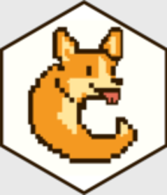

<!-- README.md is generated from README.Rmd. Please edit that file -->

```{r, include = FALSE}
knitr::opts_chunk$set(
  collapse = TRUE,
  comment = "#>",
  fig.path = "man/figures/README-"
)
```

# caugi <a href="https://caugi.org"></a>

<!-- badges: start -->
[](https://github.com/frederikfabriciusbjerre/caugi/actions/workflows/R-CMD-check.yaml)
[](https://app.codecov.io/gh/frederikfabriciusbjerre/caugi)
[](https://cran.r-project.org/package=caugi)
[](https://extendr.rs/extendr/extendr_api/)
[](https://CRAN.R-project.org/package=caugi)
<!-- badges: end -->

> **Causal Graph Interface (for R)** — a fast and flexible toolbox for building, coercing and analyzing causal graphs.

## What is `caugi`?

`caugi` (pronounced "corgi") stands for **Causal Graph Interface**. It is a _causality-first_ graph package that focuses on performance and flexibility. If you are developing scripts or algorithms in the field of causality or if you are learning about causal graphs for the first time, `caugi` is made for you. 

## Installation

You can install the released version of `caugi` from CRAN with:
```{r, eval=FALSE}
install.packages("caugi")
```

or the development version from GitHub with:
```{r, eval=FALSE}
pak::pak("frederikfabriciusbjerre/caugi")
```

### Installing Rust

On Windows and macOS, CRAN ships ready-built binaries, so `install.packages()` does not need Rust. Installing with `pak` from GitHub, or from CRAN on Linux, builds `caugi` from source, which requires Rust (rustc >= 1.80). If you don't have Rust installed, visit [rustup.rs](https://rustup.rs/) for installation instructions appropriate for your platform.

Alternatively, you may install Rust from your OS package manager.

## The basic object: `caugi`

A `caugi` graph object is the bread and butter of the `caugi` package. It is easy to create, query, and modify. 

```{r}
library(caugi)
```

You can create simple graphs as well as a number of predefined graph classes. Currently, we support the classes `"DAG"`, `"PDAG"`, `"MPDAG"`, `"CPDAG"`, `"ADMG"`, `"AG"`, `"PAG"`, `"UG"` as well as an `"UNKNOWN"` class. We plan on supporting `"MAG"` and `"SWIG"` as classes of their own in future releases.

```{r}
#| fig-width: 2
#| fig-height: 2
# a tiny DAG
cg <- caugi(
  A %-->% B + C,
  B %-->% D,
  C %-->% D,
  class = "DAG"
)

plot(cg)
```

### Edge operators

The available edges in `caugi` are listed below:

* `%-->%` (directed) 
* `%---%` (undirected)
* `%<->%` (bidirected)
* `%o->%` (partially directed)
* `%--o%` (partially undirected)
* `%o-o%` (partial)
* `%<--%`, `%<-o%` and `%o--%`, the same edges written the other way round:
  `B %<--% A` is stored as `A %-->% B`

You can register more types with `register_caugi_edge()`. caugi reasons with an edge's marks and class but keeps its glyph, so a custom glyph can carry a meaning of your own. For example, [causalDisco](https://github.com/disco-coders/causalDisco) writes a forbidden edge in background knowledge as `!-->`. Registering that glyph keeps forbidden edges apart from ordinary directed ones in a caugi graph:

```{r}
register_caugi_edge(
  glyph = "!-->",
  tail_mark = "tail",
  head_mark = "arrow",
  class = "directed",
  symmetric = FALSE
)

caugi(A %-->% B, B %!-->% C, class = "UNKNOWN")

# reset the registry to default with original edges
reset_caugi_registry()
```

In queries, `B %!-->% C` counts as a directed edge; only its glyph tells it apart.

We expect this feature to need further polishing in future releases, and we would love your input if you use this feature!

## Queries, adjustment and conversion

Query the DAG from above, find an adjustment set for the effect of `B` on `D`, and test d-separation:

```{r}
parents(cg, "D")
adjustment_set(cg, X = "B", Y = "D")
d_separated(cg, X = "B", Y = "C", Z = "A")
```

`as_caugi()` reads graphs from `igraph`, `dagitty`, `bnlearn`, `graph`, `tidygraph`, adjacency matrices (including `pcalg`'s mark coding) and edge lists, and `as_igraph()`, `as_dagitty()`, `as_bnlearn()` and `as_adjacency()` convert back. See the [reference](https://caugi.org/reference/) for all queries, adjustment, metrics and conversions.

## How it works 

`caugi` graphs are represented in a compact Compressed Sparse Row (CSR) format in Rust. `caugi` works with a front-loading philosophy. Since the `caugi` graph is stored in a CSR format, mutations of the graph are computationally expensive compared to other graph storage systems, _but_ it allows for very fast querying. In addition to the storage format of the graph itself, `caugi` also stores additional information about node relations in such a way that it allows for faster queries without blowing up the object too much.

To offset the cost of mutations, `caugi` graphs are built lazily, but you can force a build by using the function `build()`.

## Why?

It's fast, _dawg_ 🐶 See the [article on performance](https://caugi.org/articles/performance.html) on our website for benchmarks.

## Contribution

Would you like to contribute? Great! Please see [Contributing to caugi](https://caugi.org/CONTRIBUTING.html) for detailed guidelines on code style, testing, and the development workflow. Quick tips: follow the tidyverse style guide for R code, run `air format .` for R and `cargo fmt` for Rust before PRs, and write tests for new features.

Did you run into problems? That's _paw-ful_! 
Please report an [issue](https://github.com/frederikfabriciusbjerre/caugi/issues)!

